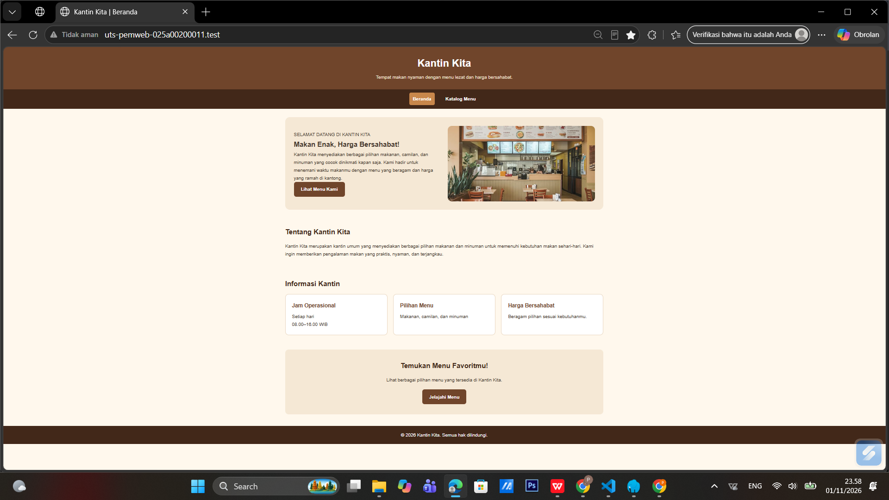
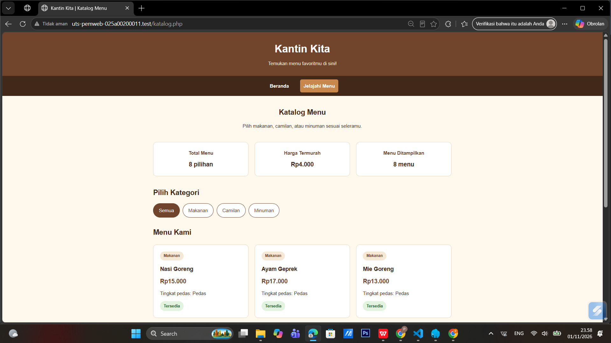
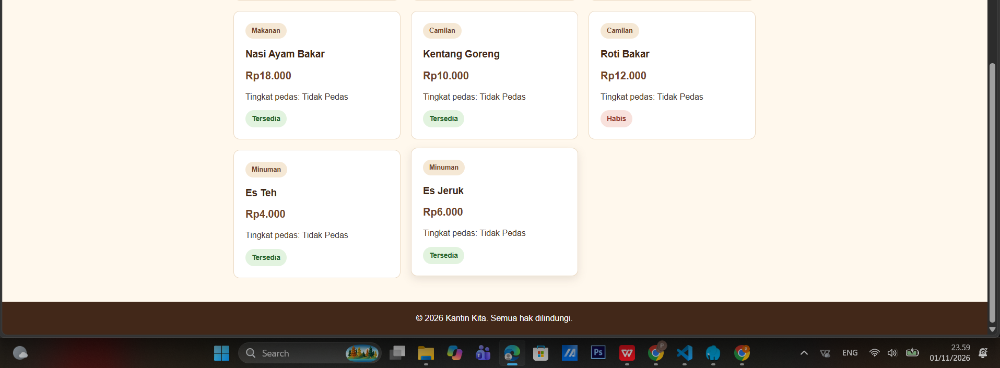

# Kantin Kita

## 1. Identitas

- **Nama:** Pratiwi Dwi Eriyani
- **NIM:** 025A00200011
- **Kelas:** A2-3A
- **Program Studi:** Informatika
- **Mata Kuliah:** Pemrograman Web

## 2. Deskripsi Proyek

Kantin Kita merupakan website sederhana yang menampilkan informasi kantin dan katalog menu berupa makanan, camilan, dan minuman. Website ini dibuat menggunakan HTML, CSS, dan PHP untuk menampilkan daftar menu, harga, kategori, tingkat kepedesan, dan ketersediaan meneu dengan tampilan yang sederhana dan mudah digunakan.

## 3. Cara Menjalankan di Localhost

Langkah-langkah menjalankan website:
1. Pastikan aplikasi Laragon sudah terinstal.
2. Simpan folder proyek uts-pemweb-025a00200011 ke dalam direktori C:\laragon\www\
3. Pastikan struktur filr sudah sesuai.
4. Buka aplikasi Laragon, kemudian klik Start All.
5. Buka browser, kemudian masukkan alamat berikut: http://uts-pemweb-025a00200011.test/
6. Website Kantin Kita akan terbuka secara otomatis di browser.

## 4. Daftar Fitur

1. **Halaman Beranda**
- File: index.php
- Menampilkan informasi umum kantin, deskripsi, jam operasional, dan pilihan menu.

2. **Navigasi Halaman**
- File: index.php, katalog.php
- Menghubungkan halaman beranda dengan halaman katalog menu.

3. **Menampilkan Daftar Menu**
- File: data.php, katalog.php
- Menyimpan dan menampilkan data makanan, camilan, dan minuman.

4. **Filter Kategori Menu**
- File: katalog.php
- Fungsi: in_array(), array_filter()
- Menyaring menu berdasarkan kategori yang dipilih.

5. **Informasi Jumlah Menu**
- File: katalog.php
- Fungsi: count()
- Menghitung jumlah seluruh menu dan jumlah menu yang sedang ditampilkan.

6. **Informasi Harga Termurah**
- File: katalog.php
- Fungsi: array_column(), min()
- Mengambil data harga dan menentukan harga menu paling murah.

7. **Informasi Tingkat Kepedasan**
- File: functions.php, katalog.php
- Fungsi: keteranganPedas()
- Menampilkan keterangan menu pedas atau tidak pedas.

8. **Status Ketersediaan Menu**
- File: data.php, katalog.php
- Menampilkan status menu, yaitu tersedia atau habis.

9. **Format Harga Rupiah**
- File: functions.php
- Fungsi: formatRupiah()
- Mengubah angka harga menjadi format mata uang Rupiah.

10. **Keamanan Output HTML**
- File: functions.php
- Fungsi: e()
- Mengamankan teks sebelum ditampilkan pada halaman HTML.

11. **Tampilan Responsif**
- File: style.css
- Mengatur tampilan website agar menyesuaikan ukuran layar laptop, tablet, dan HP.

## 5. Fungsi Array Bawaan PHP yang Digunakan

1. **in_array()**
- Memeriksa apakah kategori yang dipilih terdapat dalam daftar kategori yang tersedia.

2. **array_filter()**
- Menyaring data menu berdasarkan kategori yang dipilih pengguna.

3. **count()**
- Menghitung jumlah seluruh menu dan jumlah menu setelah difilter.

4. **array_column()**
- Mengambil seluruh nilai harga dari data menu untuk keperluan pengolahan harga.

Selain fungsi array tersebut, proyek ini juga menggunakan fungsi bawaan PHP min() untuk mencari harga menu paling murah dari daftar harga.

## 6. Tangkapan Layar Website

### A. Halaman Beranda

Halaman beranda menampilkan informasi umum Kantin Kita, deskripsi kantin, jam operasional, pilihan menu, dan tombol untuk melihat katalog menu.

### B. Halaman Katalog Menu

Halaman katalog menampilkan daftar menu makanan, camilan, dan minuman yang dilengkapi dengan harga, kategori, tingkat kepedasan, serta status ketersediaan. Pengunjung juga dapat menggunakan fitur filter untuk melihat menu berdasarkan kategori.

## 7. Sumber Referensi dan Catatan Penggunaan AI

### Sumber Referensi
- Dokumentasi PHP: https://www.php.net/manual/en/
- Dokumentasi fungsi `foreach`: https://www.php.net/manual/en/control-structures.foreach.php
- Dokumentasi `htmlspecialchars()`: https://www.php.net/manual/en/function.htmlspecialchars.php

### Catatan Penggunaan AI
Pengembangan proyek ini dibantu oleh AI untuk memperoleh penjelasan konsep PHP, menyusun struktur kode, dan memperbaiki tampilan website. Kode kemudian dipelajari, disesuaikan, dan diuji kembali agar sesuai dengan kebutuhan tugas.

---

© 2026 Kantin Kita

Dibuat sebagai proyek Ujian Tengah Semester (UTS) mata kuliah Pemrograman Web.